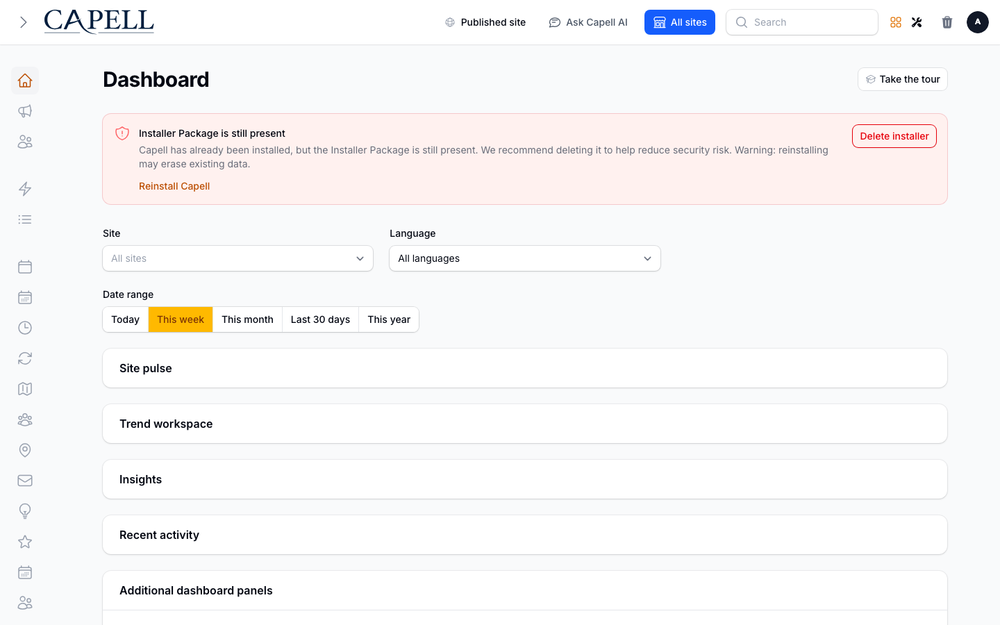
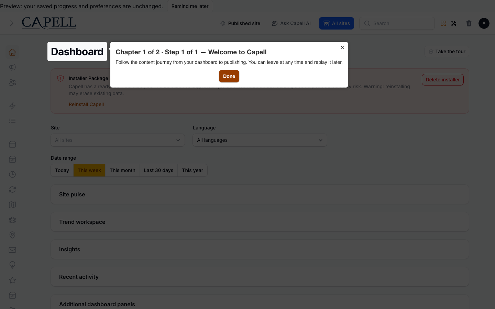

# Welcome Tour

<!-- prettier-ignore-start -->

A new editor opens the admin dashboard for the first time and wonders where to start. A Getting started checklist runs across the top, covering your site and domain, a first page, a theme and a first package. Each job has an Open link to the screen where the work is done.

Saving the site, a page appearing, a theme other than the default being switched on and a package being enabled after install each tick a job for you. Each person can also tick a job by hand. Jobs a person has no permission to open don't appear for them. Editors and every kind of admin see the checklist, and visitors never do.

Owners can also write tour steps, the notes a tour shows on each screen, in the Welcome tour settings. None come ready-made, and the checklist works without them. Each person can hide the checklist for themselves, and until they do it shows at a glance which jobs are done and which are still open.

- **Price and availability:** Check current availability and price on the [Capell Marketplace listing](https://capell.app/marketplace/extensions/welcome-tour).
- **Licence:** Check the licence terms on the [Capell Marketplace listing](https://capell.app/marketplace/extensions/welcome-tour).
- **Requires:** `PHP ^8.4`, `capell-app/admin ^1.0.66`, `capell-app/core ^1.0.75`, `jibaymcs/filament-tour ^5.0`, `laravel/framework ^12.61.1|^13.12.0`, `lorisleiva/laravel-actions ^2.8`, `spatie/laravel-package-tools ^1.15`, `spatie/laravel-settings ^3.0`.
- **Install:** `composer require capell-app/welcome-tour:@beta`.

## Quick Start

1. Install the package: `composer require capell-app/welcome-tour:@beta`.
2. For site owners and administrators: An administrator account, and **Enabled** switched on in the Welcome tour settings.
3. Open `/admin`. Sign in and open the dashboard. The Getting started checklist appears across the top. The tour does not start by itself unless presentation mode is on, and it ships with no steps: add steps in the Welcome tour settings, then choose **Take the tour** to run it. Choose **Remind me later** to hide the tour until tomorrow.
4. Check the result: The dashboard shows the Getting started checklist with the first site, page and theme tasks you have not yet finished. Next: Open the Welcome tour settings to add tour steps, limit them by role, or preview the tour as another administrator.

## For Developers

A contextual registry and focused Actions keep checklist composition separate from the Filament widget and persisted user state.

## Configure

- **Configuration files:** `config/capell-welcome-tour.php`.
- **Admin settings:** `Capell\WelcomeTour\Settings\WelcomeTourSettings`.

## Limits And Pitfalls

- Install the required Capell packages at the versions in `composer.json`: `capell-app/admin ^1.0.66`, `capell-app/core ^1.0.75`.
- Run migrations before opening package resources or public routes.
- Custom write integrations must preserve invalidation for `welcome-tour` cache tags.

## Screens And Workflow

- Capell admin dashboard with the Welcome Tour onboarding checklist (admin).
- Welcome tour overlay showing the first configured onboarding step (admin).
- Welcome Tour settings with ordinary onboarding controls and collapsed developer details (admin).
- User edit form with Show welcome tour toggle (admin).
- Capell admin dashboard with the Welcome Tour onboarding checklist with admin sidebar menu open (admin).
- Welcome Tour grouped developer authoring and destination validation (admin).
- Welcome tour advancing between onboarding steps (admin).

## Install Impact

- Required packages: `capell-app/admin`, `capell-app/core`.
- Admin navigation: no admin page or resource contribution is declared.
- Admin/editor extensions: `dashboard-widget: WelcomeTourChecklistWidgetContribution`.
- Permissions: no package permission declarations or Shield gates detected; host access rules still apply.
- Public routes: none declared.
- Database changes: package migrations are declared.
- Config: `config/capell-welcome-tour.php`.
- Settings: `Capell\WelcomeTour\Settings\WelcomeTourSettings`.
- Queues or schedules: none declared.
- Cache tags: `welcome-tour`.
- Commands: none declared.

## Troubleshooting

| Symptom | Likely cause | Check | Fix |
| --- | --- | --- | --- |
| Package surface is missing after install | Provider or manifest is not loaded | Confirm `capell.json`, package `composer.json`, and provider registration | Reinstall the package, refresh Composer autoload, and clear host caches |
| Admin screen or command fails on missing table | Package migrations have not run | Check the tables listed in `Data Model` | Run host migrations and rerun the focused package test |

## Upgrading

No manual steps between minor versions.

Read [CHANGELOG.md](CHANGELOG.md) before upgrading.

## Next Steps

- [Package docs](docs/README.md)
- [Overview](docs/overview.md)
- [Worked extension examples](docs/extension-contracts.md)
- [Admin guide](docs/admin-guide.md)
- Configuration files: [`config/capell-welcome-tour.php`](config/capell-welcome-tour.php).
- [Troubleshooting](#troubleshooting)
- [Developer reference](docs/reference.md)
- [Marketplace assets](docs/assets/marketplace/)
- [Capell content language plan](../../docs/CONTENT_LANGUAGE_PLAN.md)
- [Capell documentation design system](../../docs/DESIGN_SYSTEM.md)
- [Capell and package ERD notes](../../docs/erd/capell-and-package-erds.md)

<!-- prettier-ignore-end -->
